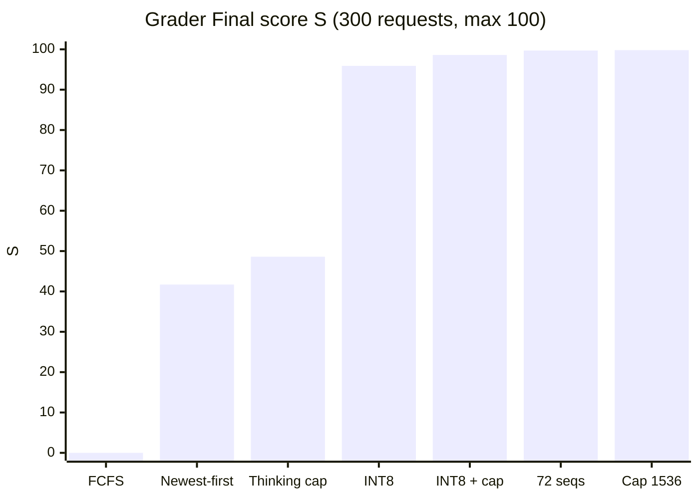

<div align="center">

# 🌿 GreenMind — More Useful Answers per Joule

**Serving `CMKL/MANGO1.5-Qwen3.5-9B` on one A100 40GB so that as many answers as possible arrive on time,<br>
for as few GPU joules as possible.**

*GreenMind LLM Inference Optimization Hackathon · October 2026*


[](https://huggingface.co/aungthuhein-dev/MANGO1.5-Qwen3.5-9B-W8A8-INT8)

[**Results**](#-results) · [**How it works**](#-how-we-got-there) · [**Run it**](#-run-it) · [**Experiments**](EXPERIMENTS.md) · [**What failed**](FAILED.md) · [**Pitch notes**](docs/pitch_notes.md)

</div>

---

> [!IMPORTANT]
> **Best Final: S = 99.8** — accuracy, energy and latency at full marks (A = sE = sL = 1.00), peak throughput sT = 0.99.
> 298 of 300 requests met every SLO, at **134 J per request** and **4.54×** the baseline's on-time answers per joule.

> [!NOTE]
> **Weights.** The submitted model is **our own INT8 W8A8 quantization**, made during the event from the official BF16
> weights: [aungthuhein-dev/MANGO1.5-Qwen3.5-9B-W8A8-INT8](https://huggingface.co/aungthuhein-dev/MANGO1.5-Qwen3.5-9B-W8A8-INT8)
> (build script: [`quantize/w8a8_int8.py`](quantize/w8a8_int8.py)). Earlier runs used the organizers' originals:
> [`CMKL/MANGO1.5-Qwen3.5-9B`](https://huggingface.co/CMKL/MANGO1.5-Qwen3.5-9B) and
> [`CMKL/MANGO1.5-Qwen3.5-9B-AWQ-W4A16-mtp`](https://huggingface.co/CMKL/MANGO1.5-Qwen3.5-9B-AWQ-W4A16-mtp).

## 📈 Results



| Milestone | Final S | On time | Efficiency | p95 first token | p95 per token | What changed |
|---|:-:|:-:|:-:|:-:|:-:|---|
| AWQ 4-bit + MTP, first-come-first-served | 0.0 | 87/300 | 0.86× | 6.2 s | 62 ms | the peak queue made every new request late |
| + newest-first, 44 seqs, long-prefill threshold | 41.7 | 191/300 | 1.89× | 46.9 s | 48 ms | serve the request that can still be on time |
| + thinking budget 1024 | 48.6 | 205/300 | 2.52× | 32.0 s | 48 ms | fewer tokens per answer (accuracy dipped: A 0.90) |
| **Our INT8 W8A8 model** + MTP2, 64 seqs | 95.9 | 279/300 | 2.84× | 1.3 s | 33 ms | INT8 tensor cores — the backlog disappears |
| + thinking budget 2048 | 98.6 | 286/300 | 3.80× | 1.7 s | 36 ms | energy at full marks, accuracy *up* (R 1.063) |
| + 72 concurrent sequences | 99.7 | 295/300 | 3.96× | 1.5 s | 34 ms | peak share 0.93 → 0.98 |
| **+ thinking budget 1536** | **99.8** | **298/300** | **4.54×** | **1.5 s** | **35 ms** | peak share 0.99, 134 J/request |

<details>
<summary><b>All 16 Final submissions</b> (S = 100 × A × sE<sup>0.6</sup> × sT<sup>0.2</sup> × sL<sup>0.2</sup>)</summary>

| # | Config | S | A | sE | sT | sL | Efficiency vs baseline | J / request | p95 TTFT | p95 TPOT | SLO met |
|---|---|---|---|---|---|---|---|---|---|---|---|
| – | Baseline (default `vllm serve`, BF16) | 0 | 1.00 | 0 | – | – | 1.00x | – | – | – | – |
| 1 | AWQ + MTP, prefix cache, 64 seqs, FCFS | 0.0 | 0.98 | 0.00 | 0.02 | 0.27 | 0.86x | 207 | 6.2 s | 62 ms | 87/300 |
| 2 | + newest-first scheduling, 48 seqs | 33.2 | 1.00 | 0.44 | 0.37 | 0.12 | 1.63x | 194 | 41.9 s | 51 ms | 154/300 |
| 3 | + newest-first scheduling, 40 seqs | 40.0 | 1.00 | 0.60 | 0.41 | 0.12 | 1.94x | 179 | 50.6 s | 44 ms | 169/300 |
| 4 | #3 + prefill chunk 16384 | 29.0 | 0.95 | 0.40 | 0.38 | 0.11 | 1.56x | 214 | 50.0 s | 44 ms | 163/300 |
| 5 | #3 with MTP off | 36.3 | 1.00 | 0.50 | 0.45 | 0.11 | 1.73x | 208 | 49.2 s | 42 ms | 176/300 |
| 6 | #3 with 350 W power cap | 32.8 | 1.00 | 0.48 | 0.33 | 0.10 | 1.69x | 179 | 57.2 s | 47 ms | 148/300 |
| 7 | #3 with 44 seqs | 40.9 | 1.00 | 0.60 | 0.39 | 0.13 | 1.94x | 172 | 41.9 s | 44 ms | 163/300 |
| 8 | #7 + long-prefill threshold 2048, async scheduling off | 41.7 | 1.00 | 0.58 | 0.50 | 0.13 | 1.89x | 207 | 46.9 s | 48 ms | 191/300 |
| 9 | #8 re-run (same config) | 35.2 | 1.00 | 0.47 | 0.46 | 0.11 | 1.68x | 212 | 51.6 s | 49 ms | 174/300 |
| 10 | #8 + thinking budget 1024 tokens | 48.6 | 0.90 | 0.84 | 0.54 | 0.14 | 2.52x | 167 | 32.0 s | 48 ms | 205/300 |
| 11 | #8 + thinking budget 1536 tokens | 48.1 | 1.00 | 0.81 | 0.43 | 0.11 | 2.44x | 152 | 45.6 s | 51 ms | 181/300 |
| 12 | Our INT8 W8A8 model + MTP2, 64 seqs, prefill 2048, long-prefill threshold 1024, newest-first, no thinking cap | 95.9 | 1.00 | 0.95 | 0.94 | 1.00 | 2.84x | 201 | 1.3 s | 33 ms | 279/300 |
| 13 | #12 + thinking budget 2048 tokens | 98.6 | 1.00 | 1.00 | 0.93 | 1.00 | 3.80x | 154 | 1.7 s | 36 ms | 286/300 |
| 14 | #13 with 72 concurrent sequences | 99.7 | 1.00 | 1.00 | 0.98 | 1.00 | 3.96x | 152 | 1.5 s | 34 ms | 295/300 |
| 15 | #14 with 80 concurrent sequences | 99.6 | 1.00 | 1.00 | 0.98 | 1.00 | 3.76x | 160 | 1.6 s | 36 ms | 294/300 |
| 16 | **#14 with thinking budget 1536 (best)** | **99.8** | **1.00** | **1.00** | **0.99** | **1.00** | **4.54x** | **134** | 1.5 s | 35 ms | **298/300** |

Runs 4–6 each looked better than #3 in a single local run and lost on the grader. Grader run-to-run noise (about
±10% energy, ±20 on-time requests on AWQ) was larger than those effects, so from then on a candidate only got a Final
after beating the current best across **repeated cold-cache runs**. On the lighter 100-request Validation trace, the
AWQ + MTP setup scored 48.7 and our INT8 model 93.5.

</details>

## 🧭 How we got there

> [!TIP]
> The whole project followed the organizers' loop: **Measure → Hypothesize → Change one thing → Re-measure → Explain.**
> Every run is in [EXPERIMENTS.md](EXPERIMENTS.md); every failure, with its explanation, is in [FAILED.md](FAILED.md).

### 1 · Free memory so more requests fit

The default server isn't short of power, it's short of **memory**: BF16 weights take 17.6 GB, the KV cache fills to
99% at the 4 req/s peak, ~75 requests run while 100+ queue, and almost nothing meets the SLO.

| Change | Effect |
|---|---|
| AWQ W4A16 weights (organizers' model) | 17.6 → 7.7 GB of weights, KV cache +66%, same accuracy |
| MTP speculative decoding, 2 drafts | ~2.2–2.9 tokens accepted per forward pass |
| `--language-model-only` | the grader is text-only: no vision encoder memory |
| Prefix caching on | agent traffic reuses tool schemas and history; turning it off cost 213 → 279 J/request |

### 2 · Serve the newest request first under overload

The Final's peak sends work faster than one A100 can finish it. First-come-first-served lets the queue grow until
**every** new request misses its 0.5 s first-token deadline (Final: 87/300 on time, peak share 0.02). Under overload,
only a request that just arrived can still be on time — so we admit those first. Requests already stuck in the queue
were late anyway; they still complete, with the same accuracy, in the quiet phase.

~40 lines of in-process vLLM middleware ([`serve/newest_first.py`](serve/newest_first.py)) on vLLM's priority
scheduler — the organizers confirmed server-side prioritization is allowed. Combined with a concurrency cap and a
long-prefill threshold: **0.0 → 41.7**.

### 3 · Our own INT8 model for the A100's INT8 tensor cores

> [!NOTE]
> AWQ stores 4-bit weights but still multiplies in 16-bit. The A100 has **INT8 tensor cores (~2× its 16-bit rate)**
> and no FP8 — so 4-bit AWQ left the fastest hardware path unused.

We built a data-free **INT8 W8A8** model from the official BF16 weights with llm-compressor
([`quantize/w8a8_int8.py`](quantize/w8a8_int8.py)):

| Quantized to INT8 | Kept in BF16 |
|---|---|
| MLP `gate/up/down_proj` · full attention `q/k/v/o_proj` · Gated-DeltaNet `in_proj_qkv`, `in_proj_z`, `out_proj` | DeltaNet gates `in_proj_a/b` · `lm_head` · MTP head · vision tower |
| per-channel weights, **dynamic per-token activations** (no calibration data) | copied unchanged from the BF16 checkpoint |

vLLM serves it on `CutlassInt8ScaledMMLinearKernel`, and MTP still accepts ~2.9 tokens per step. Decode became fast
enough that the peak no longer builds a backlog: p95 first-token time **32 s → 1.3 s**, latency score 0.14 → 1.00,
accuracy unchanged. **48.6 → 95.9.**

### 4 · Bound the reasoning, then fill the GPU

> [!NOTE]
> The organizers' GPU mentor confirmed on Discord: *"Yes, you can cap the thinking budget."* Thinking stays on for every
> request; `max_tokens`, temperature and sampling are exactly what the grader sends.

The middleware sets vLLM's `thinking_token_budget` on each request. A cap of **2048** cut energy by 23% and *raised*
accuracy (R 1.063) — it stops the long reasoning chains that used to hit the 8,192-token limit and end without an
answer (**98.6**). With the backlog gone, the only factor left below 1.00 was the peak share: **72 concurrent
sequences** lifted it to 0.98 (**99.7**), and tightening the cap to **1536** brought it to 0.99 at 134 J/request
(**99.8**).

## 🚀 Run it

```bash
# 1. Build the INT8 W8A8 model from the official BF16 weights (data-free, ~1 min on CPU; separate venv with llm-compressor)
~/lc/bin/python quantize/w8a8_int8.py <CMKL/MANGO1.5-Qwen3.5-9B snapshot dir> ~/models/MANGO1.5-Qwen3.5-9B-W8A8-INT8
#    or download it: https://huggingface.co/aungthuhein-dev/MANGO1.5-Qwen3.5-9B-W8A8-INT8

# 2. Serve it (best run #16; GPU at its default 400 W limit)
THINK_BUDGET=1536 VLLM_USE_FLASHINFER_SAMPLER=0 PYTHONPATH=serve \
vllm serve ~/models/MANGO1.5-Qwen3.5-9B-W8A8-INT8 \
  --served-model-name MANGO1.5-Qwen3.5-9B-W8A8-INT8 CMKL/MANGO1.5-Qwen3.5-9B --host 0.0.0.0 --port 8000 \
  --enable-auto-tool-choice --tool-call-parser qwen3_coder --reasoning-parser qwen3 \
  --max-model-len 49152 --gpu-memory-utilization 0.92 \
  --max-num-seqs 72 --max-num-batched-tokens 2048 --enable-chunked-prefill --long-prefill-token-threshold 1024 \
  --language-model-only --enable-prefix-caching \
  --speculative-config '{"method":"mtp","num_speculative_tokens":2}' \
  --scheduling-policy priority --middleware newest_first.NewestFirst
```

Or with our script: `PREFIX_CACHE=1 MAX_SEQS=72 BATCHED_TOKENS=2048 LONG_PREFILL=1024 SCHED=newest THINK_BUDGET=1536 ./serve/serve.sh int8_mtp`
(vLLM 0.32.0, installed by [`serve/install.sh`](serve/install.sh)).

> [!WARNING]
> `VLLM_USE_FLASHINFER_SAMPLER=0` is needed on machines without a CUDA toolkit (`nvcc`): FlashInfer's sampler is
> JIT-compiled at start-up. Output is identical at temperature 0.

## 🗂️ Repository

| Path | What's inside |
|---|---|
| [`quantize/`](quantize) | `w8a8_int8.py` (INT8 W8A8 build), `MODEL_CARD.md` |
| [`serve/`](serve) | `install.sh`, `serve.sh` (profiles), `newest_first.py` (priority + thinking-budget middleware), `slo_scheduler.py` (tried, lost), `power.sh`, sweep scripts |
| [`harness/`](harness) | `workload.py` (open-data workload), `run.py` (load runner + NVML energy), `score.py` (S estimate), `aggregate.py`, `decode_bench.py` |
| [`results/`](results) | one folder per local run (requests, items, power trace, summary, score); `_launch/` = exact server commands and logs |
| [`docs/pitch_notes.md`](docs/pitch_notes.md) | pitch outline, impact numbers, Q&A |
| [`EXPERIMENTS.md`](EXPERIMENTS.md) · [`FAILED.md`](FAILED.md) | every run · every failure with its explanation |

<details>
<summary><b>Local harness: how we tested before spending a Final</b></summary>

`harness/workload.py` builds a gradable workload with the grader's class mix from open data only (MMLU, GSM8K,
Belebele `tha_Thai`, synthetic needle-in-documents and fake-tool agentic episodes). `harness/run.py load` replays it
open-loop (ramp → 4 req/s peak → 1 req/s quiet) with thinking on, `max_tokens` 8192, temperature 0, and reads GPU
joules from NVML. `harness/score.py` applies the briefing's formulas.

What it got right and wrong, compared with the grader:
- Energy efficiency and accuracy tracked the grader closely (1.86× local vs 1.76× grader).
- Its 300-item run reproduces the Final's overload, which the 100-request Validation trace never shows.
- It had few shared prefixes, so it couldn't see the value of prefix caching — the grader could.
- Replaying the same prompts with a warm prefix cache made later runs look far too good: every local comparison
  restarts the server first.
- Energy must be compared per output token: output length varies ±8% between runs.

```bash
./serve/install.sh                                         # uv venv + vLLM + deps
python harness/workload.py --out data/workload.jsonl       # 300 items
./serve/serve.sh int8_mtp                                  # terminal 1
python harness/run.py load --name my-run                   # terminal 2
python harness/score.py results/my-run --baseline results/baseline
```

Self-test without a GPU: `python tests/mock_server.py`, then
`python harness/workload.py --out data/mock.jsonl --synthetic --scale 0.2` and
`python harness/run.py load --name mock --workload data/mock.jsonl --base-url http://127.0.0.1:8765/v1 --peak-rate 20`.

</details>

<div align="center">

---

*Built during the GreenMind LLM Inference Optimization Hackathon, October 2026.*

</div>
